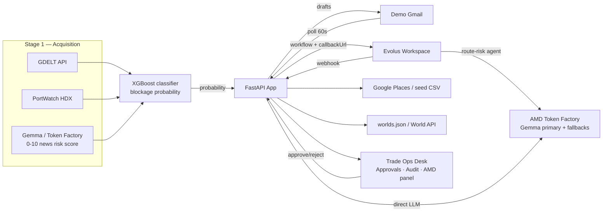

# Orbitra Reroute — Build Plan

**Deadline:** 18 Oct 2026 14:00 GST · **Track:** Reinvent Commerce + Evolus + Gemma

## Requirements → Implementation → Demo moments

| Requirement | How | Demo moment |
|---|---|---|
| AMD powers the product | Gemma-4-31B-IT on Token Factory (inference) + XGBoost/LSTM (training, deferred) | AMD panel: model, host, latency, tokens, fallbacks |
| Free Evolus event workspace | Created from event link; 50k credits | Walk through 5 blocks in workspace |
| Main agent on open AMD model | `route-risk` agent → Gemma via Token Factory | Agent model setting shown |
| ≥ 2 Evolus building blocks (targeting 5) | Extractor, Library, Agent, Workflow, AI Tools | Live walkthrough |
| App drives Evolus via API | FastAPI calls workflow execute, extractor, AI Tools, agent chat | Audit log shows each call |
| Human approval gate | Drafts only; `drafts.send` on click | Approve in UI → email delivered |
| Containerised public repo | Dockerfile + docker-compose + README | `docker compose up` from clean clone |
| Reinvent Commerce | Cold-chain reroute: quality (workbook), margin (cost P10/P50/P90), availability (provider qualification) | Cost chart + workbook download |
| Originality | Situation room: World Labs cached world changes with recommended port | 3D world opens; thumbnail changes |

## Architecture

## Phase plan (against 18 Oct 14:00 GST)

| Phase | Window GST | Scope | Exit check |
|---|---|---|---|
| **P0 Setup** ✅ | Done | Scaffold, CLAUDE.md, CDM, smoke scripts, Dockerfile, app hello page | `make smoke` passes |
| **P1 Vertical slice** | 18:45–21:45 | Gmail poll → Evolus workflow (extractor + route-risk) → risk card → workbook → W2 spatial → Trade Ops draft → approve → sink | All 9 steps produce real output |
| **Checkpoint A** | ~21:45 | Deployed URL, README, 2-min recording, draft lablab submission | Draft on lablab |
| **P2 Depth** | 21:45–00:30 | Places qualification; outreach drafts; cost model; Finance + Compliance via AI Tools; AMD panel | Scenario (a) end-to-end |
| **P3 Range** | 00:30–02:30 | Portuguese translate; noise archived; situation room; W3 provider spatial; chat widget | Scenarios (b)–(e) correct |
| **Sleep** | 02:30–08:30 | — | — |
| **P4 Ship** | 08:30–11:30 | Scenario tests, link checks, video (5 min), slides, cover, final submit | Submitted 2.5h before deadline |
| **W4 stretch** | P3 if ahead | On-demand World API behind flag | Only if P3 done early |

**W1 parallel:** Teammate generates Marble worlds (Jeddah, Salalah, Jebel Ali) → drops links into `config/worlds.json` by ~21:30 GST.
**ML training:** `make train` → `models/blockage_classifier.pkl` (XGBoost, <30s). LSTM deferred.

## Top risks

| Risk | Mitigation |
|---|---|
| Evolus Plan A rejected (Token Factory ≠ valid AMD endpoint) | Proceed as Plan A; Plan B = dedicated vLLM; no code change (env vars) |
| Token Factory RPM limit (20 RPM confirmed) | Semaphore ≤ 4 + 15 RPM bucket; AMD panel shows fallbacks |
| Evolus translate option name wrong | Check workspace interactive API; `language` or `target` may be the correct key |
| W1 worlds not ready by P1 | Graceful degradation: notification goes without link |
| Gmail OAuth not set up | Run `scripts/gmail_auth.py` before P1 |

## Cut order

W4 → chat widget → W3 provider spatial → Google Places (seed CSV) → Portuguese path → W2/W1

**Never cut:** Gemma on AMD · ≥ 2 Evolus blocks via API · human approval gate · containerised repo · video
